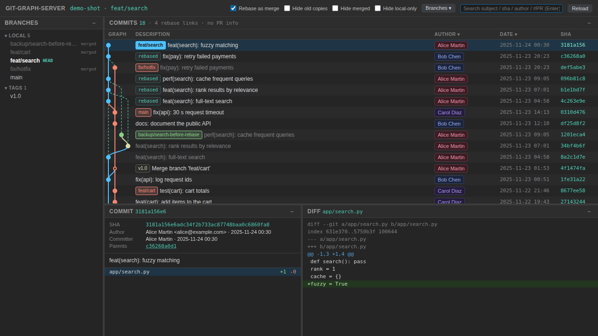

# git-graph-server

[](https://pypi.org/project/git-graph-server/)
[](https://github.com/Wadjinny/git-graph-server/actions/workflows/ci.yml)
[](https://github.com/Wadjinny/git-graph-server/blob/main/LICENSE)

A local web UI for the branch graph of the git repo you're in, in the style of SourceGit, with one thing other graphs can't do: **show rebased and squashed commits connected to the commits they were copied from, the way a merge is drawn.**



## Install and run

You need [git](https://git-scm.com/). From inside any git repo:

```bash
uvx git-graph-server
```

or install it once with `pipx install git-graph-server` (or `pip install git-graph-server`) and run `git-graph-server`. It serves the graph on http://127.0.0.1:7420 and opens your browser.

```
git-graph-server [path] [--port 7420] [--limit 3000] [--rebase] [--no-open] [--prs N | --no-prs] [--version]
```

| Option | |
|---|---|
| `path` | repo to show (default: the current directory) |
| `--port` | port to serve on; a free one is picked if it's taken |
| `--limit` | how many commits to load, newest first, across all branches |
| `--rebase` | start with **Rebase as merge** on |
| `--no-open` | don't open the browser |
| `--prs N` / `--no-prs` | how many GitHub PRs to load (default 300), or none |

## Why

Git keeps no record of which commit a rebase, cherry-pick or squash copied. A merge commit lists both branches as parents, so every graph draws it; a rebased branch just looks like unrelated commits next to its old version.

git-graph-server finds the copies itself. Two commits count as copies when either:

- their diffs are the same (`git patch-id --stable`), or
- their author, author date and subject are the same, which catches rebases where you fixed a conflict.

With **Rebase as merge** on, each copy gets a dashed teal line to its previous version, and the commit panel says "Rebased from / to".

## Features

- **Graph**: colored lanes, branch and tag labels in their lane's color, zebra rows, commit details and per-file diffs.
- **Hide old copies**: hide the gray pre-rebase commits and reconnect what was built on them.
- **Hide merged**: hide branches whose work is already in another branch (merged PR, merge commit, or all commits rebased or squashed elsewhere); merged-in work folds into its merge commit, like `git log --first-parent`. Hover a dimmed branch to see why it counts as merged.
- **Hide local-only**: hide local branches that were never pushed.
- **Branches ▾**: show only the lineage of some branches (double-click a branch in the sidebar to focus it).
- **Author ▾**: show only some people; spellings of the same name are merged and each person gets a color.
- **Date ▾**: today, yesterday, this week, this month, or exact days from a year, month and day tree.
- **Panels**: drag the dividers to resize, drag one to an edge (or click –) to collapse a panel, drag back to reopen.
- **Search**: subject, SHA, author or `#PR` number (Enter jumps to the next match).

### GitHub PRs

If the [`gh`](https://cli.github.com/) CLI is installed and logged in, git-graph-server also loads the repo's merged and open PRs:

- PR numbers on commits (click to open the PR): solid on what landed, faded on original commits a squash or rebase replaced, green for open PRs, grey for drafts; open PRs also appear next to their branch.
- The commit panel shows the PR title, how it was merged (squash, rebase or merge commit), and its description and comments (collapsed, loaded on demand, Markdown rendered).
- **Confirmed links**: a chain of copies that holds both a PR's original commit and what it landed as gets ✓ PR #N.
- **Added links**: pairs only GitHub knows about, such as a squash of several commits, are drawn in purple.

## Good to know

- The server listens on 127.0.0.1 only; the page can read the repo's history and diffs.
- PR descriptions and comments are rendered with [marked](https://marked.js.org/) and sanitized with [DOMPurify](https://github.com/cure53/DOMPurify), loaded from a CDN with integrity hashes. Offline, they show as plain text.
- No Python dependencies; Python 3.10 or newer.

## Develop

```bash
git clone https://github.com/Wadjinny/git-graph-server
cd your/repo && uv run --project /path/to/git-graph-server git-graph-server
uv run python -m unittest discover tests      # from the project folder
```

`uvx --from <local path>` caches the first build and won't pick up your edits, so use `uv run --project` while developing.

### Release

1. Update `version` in `pyproject.toml` and `CHANGELOG.md`.
2. Commit, then tag and push: `git tag v0.1.0 && git push origin v0.1.0`.
3. The **Release** workflow runs the tests, builds, publishes to PyPI through trusted publishing (no token) and creates a GitHub release.

## License

[MIT](https://github.com/Wadjinny/git-graph-server/blob/main/LICENSE)
